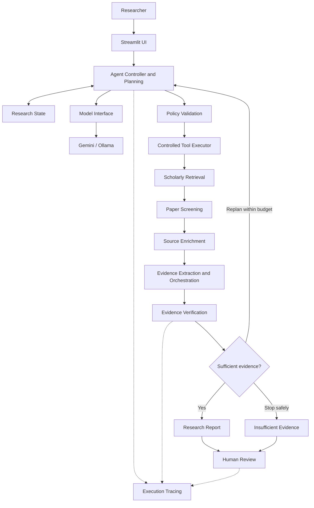

# SARA V3 - System Architecture

## Architecture Notes

- The model is a decision component, not the entire agent.
- Tool requests pass through policy validation.
- Scholarly information enters as untrusted source data.
- Evidence verification preserves provenance and uncertainty.
- The research workflow follows bounded execution limits.
- Human oversight and safe termination are supported.
- State and traces provide execution observability.

This is a logical architecture diagram, not an exact function-call graph.
